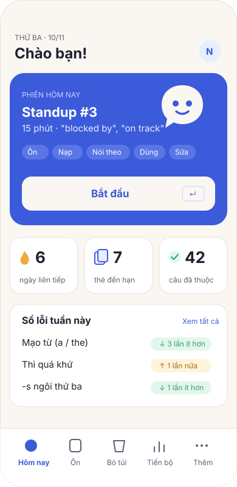
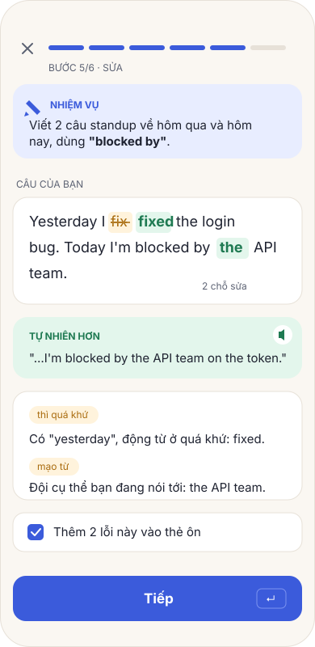
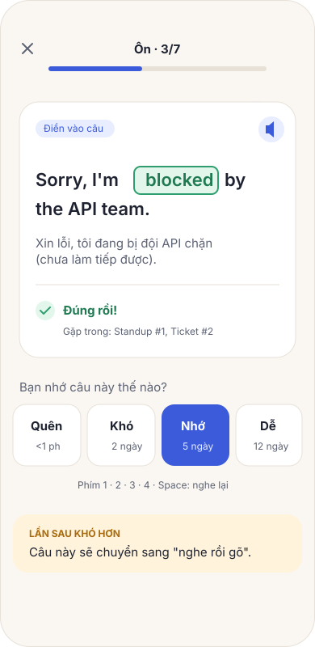
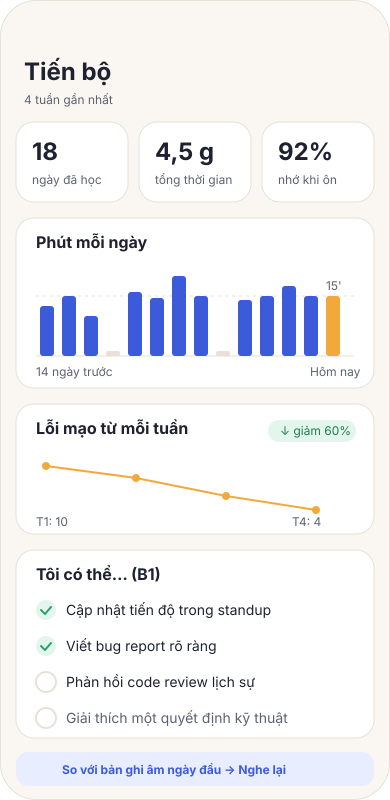

# FLUENTLOOP – PHÁC THẢO SẢN PHẨM

**Phiên bản:** 0.1 (bản nháp)
**Ngày:** 2026-11-10
**Nguồn gốc:** tách từ Lingua Quest. Bỏ lớp game (3D, đảo, NPC, quest), giữ phần học: FSRS, giọng nói, AI dạng BYOK.
**Nhân sự:** 1 người (solo)
**Nền tảng:** web (PWA), ưu tiên mobile, desktop dùng tốt bằng bàn phím

> **Một câu:** mỗi ngày 15 phút, học tiếng Anh **của chính công việc mình**, theo một vòng lặp cố định gồm *nạp → nói theo → dùng → sửa → ôn*. Lỗi của chính mình trở thành bài ôn của ngày mai.



---

## 1. Vì sao đổi hướng

| Lingua Quest (game) | FluentLoop |
|---|---|
| Phải xây thế giới 3D, NPC, cốt truyện, sự cố | Nội dung là **đoạn văn ngắn + nhiệm vụ**, viết bằng JSON/Markdown |
| Mỗi sự cố mới tốn vài ngày thiết kế | Thêm một bài mất khoảng 15 phút (AI soạn nháp, người duyệt) |
| Tiếng Anh là phương tiện chơi, nên khó đo đã học được gì | Mỗi ngày có đầu ra đo được: câu đã viết, lỗi đã sửa, thẻ đã nhớ |
| Nặng GPU, khó chạy trên điện thoại | Trang web nhẹ, chạy offline (PWA) |
| Nhiều phần phải giữ đồng bộ | **Một app, không server**, chạy bằng `npm install && npm run dev` |

Giữ lại từ Lingua Quest:
- **Ôn ngắt quãng FSRS** (`ts-fsrs`).
- **Giọng nói:** nhận dạng (STT) và đọc (TTS) bằng Web Speech API.
- **AI dạng BYOK** (Gemini/OpenRouter) gọi thẳng từ trình duyệt, ưu tiên luật.
- Nguyên tắc **"không có dấu X đỏ"** và **"luôn biết bước tiếp theo"**.

---

## 2. Người dùng

### 2.1 Trước mắt: chính bạn, ngành phần mềm/IT
> **Giả định cần xác nhận:** bạn làm phần mềm/IT, đọc tài liệu được nhưng viết và nói chưa tự nhiên. Nếu sai thì chỉ cần đổi gói nội dung (mục 7), kiến trúc giữ nguyên.

Tình huống cần tiếng Anh: daily standup, viết ticket/bug report, mô tả và review PR, đọc docs và thông báo lỗi, chat Slack/email với đồng nghiệp hoặc khách nước ngoài, họp kỹ thuật, demo, phỏng vấn.

### 2.2 Sau này: người làm ngành khác
Điều dưỡng, khách sạn và nhà hàng, bán hàng và chăm sóc khách hàng, kế toán, xuất nhập khẩu, hướng dẫn viên, học sinh ôn thi. Những người này có ba điểm khác dev:
- **Không tự lấy được API key**, nên app phải dùng tốt khi **không có AI** (mục 9.3).
- Cần giao diện tiếng Việt rõ ràng, không dùng thuật ngữ kỹ thuật.
- Học chủ yếu trên điện thoại, mỗi lần vài phút.

Vì vậy, ngay từ bản đầu: **giao diện và luồng không được giả định người dùng là dev.** Chỉ nội dung mới mang màu ngành.

---

## 3. Phương pháp học (các cách "hiện đại" có bằng chứng)

| Nguyên lý | Áp dụng trong app |
|---|---|
| **Comprehensible input (i+1)**: nạp nội dung hiểu được khoảng 95%, hơi khó hơn một chút | Đoạn văn ngắn đúng thể loại ngành (ticket, email, standup), mức CEFR khớp với người học, chạm vào là xem nghĩa |
| **Học cụm, không học từ rời (lexical chunks)** | Đơn vị ghi nhớ là **câu và cụm** (*"Could you take a look at…"*), không phải từ đơn |
| **Retrieval practice**: tự nhớ lại tốt hơn đọc lại | Mọi bài ôn đều bắt **nhớ ra** (điền vào câu, nghe rồi gõ, nói lại), không phải "xem rồi bấm biết" |
| **Spaced repetition (FSRS)** | Lịch ôn tự động. Giới hạn số thẻ mỗi ngày để không dồn thành núi |
| **Interleaving**: trộn bài cũ vào bài mới | Đoạn văn mới cố ý chứa 1–2 cụm cũ sắp đến hạn ôn |
| **Pushed output**: buộc phải nói/viết | Mỗi phiên có một nhiệm vụ viết hoặc nói thật, dùng lại cụm vừa học |
| **Feedback ngay, tập trung vào lỗi của mình** | Sửa dạng diff, gợi ý cách nói tự nhiên hơn, giải thích ngắn bằng tiếng Việt. **Lỗi biến thành thẻ ôn** |
| **Shadowing**: nghe rồi nói đè theo | Câu chính được đọc chậm rồi đọc thường, người học nói theo, app so khớp từng từ |
| **Micro-learning, ngày "làm xong được"** | Phiên 5/15/30 phút, có điểm kết thúc rõ ràng ("Xong hôm nay"), không có vòng lặp vô tận |
| **Học trên nội dung của chính mình** | "Bỏ túi": dán email/ticket/đoạn docs thật, app rút ra câu để học |
| **Lỗi đặc trưng người Việt** | Thẻ lỗi có nhãn: mạo từ, -s/-ed, thì, âm cuối, /θ/ /ð/, /ʃ/–/s/... Theo dõi lỗi nào còn lặp lại |

Không làm: gamification nặng (điểm, bảng xếp hạng, tim), học ngữ pháp theo chương, thẻ "biết/không biết" kiểu thụ động.

---

## 4. Vòng lặp mỗi ngày (trái tim của app)

Một **phiên** khoảng 15 phút (chỉnh được 5/15/30), có 6 bước cố định. Thanh tiến độ trên cùng luôn cho biết đang ở bước nào và còn mấy bước.

| # | Bước | Thời lượng | Người học làm gì | Có AI | Không có AI |
|---|---|---|---|---|---|
| 1 | **Ôn** (Warm-up) | ≤3' | Thẻ đến hạn: điền vào câu, nghe rồi gõ, nói lại | Chấm câu nói/viết tự do | So khớp chữ, cho phép lệch nhỏ (edit distance) |
| 2 | **Nạp** (Input) | 3–4' | Đọc hoặc nghe một đoạn ngắn (ticket, email, đoạn standup). Chạm vào cụm để xem nghĩa, lưu câu hay | Giải thích theo ngữ cảnh | Nghĩa viết sẵn trong gói nội dung |
| 3 | **Nói theo** (Shadow) | 2–3' | 2–3 câu chính: nghe, nói theo, xem từ nào máy chưa nghe ra | – | Web Speech, so khớp từng từ |
| 4 | **Dùng** (Produce) | 4–5' | Nhiệm vụ thật, ví dụ *"Viết 2 câu standup về việc hôm qua, dùng 'blocked by'"*. Gõ hoặc nói | Sửa lỗi, gợi ý tự nhiên hơn | So với câu mẫu, kiểm tra có dùng cụm bắt buộc, rồi tự chấm |
| 5 | **Sửa** (Feedback) | 1–2' | Xem diff, đọc giải thích tiếng Việt, chọn lỗi nào thành thẻ ôn | Gắn nhãn lỗi | Gắn nhãn bằng luật đơn giản và tự chọn |
| 6 | **Chốt** | 30" | "Hôm nay: 4 câu mới, 2 lỗi thành thẻ. Mai ôn 7 thẻ." Nút **Xong hôm nay** | – | – |

Quy tắc UX của vòng lặp:
- **Mỗi màn hình chỉ có một nút chính.** Nút đó luôn ở cùng một chỗ: góc dưới trên mobile, phím `Enter` trên desktop.
- **Bỏ qua được nhưng không mất gì:** bước bị bỏ được ghi lại, và mai sẽ hỏi lại nhẹ nhàng.
- **Dừng giữa chừng rồi quay lại** thì tiếp tục đúng chỗ (lưu sau mỗi bước).
- Ôn **có trần**, mặc định tối đa 20 thẻ mỗi ngày. Thẻ thừa dời sang mai, không bao giờ hiện "bạn nợ 143 thẻ".



---

## 5. Màn hình

| Màn hình | Mục đích | Ghi chú |
|---|---|---|
| **Chào mừng / Onboarding** (3 bước) | Chọn ngành → tự đánh giá và bài kiểm tra nhanh 2 phút → chọn số phút mỗi ngày | **Không** hỏi key AI ở đây. Gợi ý ghi âm 1 phút làm mốc so sánh (tùy chọn) |
| **Hôm nay** (trang chủ) | Một thẻ lớn "Phiên hôm nay · 15 phút · Bắt đầu" + 3 con số nhỏ | Nếu đã xong thì hiện "Xong rồi! Muốn học thêm: Ôn thêm · Hội thoại · Bỏ túi" |
| **Phiên học** | 6 bước ở mục 4, toàn màn hình, ít thứ gây phân tâm | Phím tắt: `Enter` tiếp, `Space` nghe lại, `M` micro, `1–4` chấm thẻ |
| **Ôn** | Ôn riêng ngoài phiên | Dạng thẻ thay đổi theo mức nhớ (mục 6) |
| **Hội thoại** (Roleplay) | Nói chuyện với nhân vật: tech lead, PM, khách hàng, người phỏng vấn | Cần AI. Không có AI thì dùng kịch bản rẽ nhánh viết sẵn |
| **Bỏ túi** (Capture) | Dán đoạn văn thật, app tách câu, chọn câu muốn học | Có AI: giải thích và tạo nhiệm vụ. Không có AI: tạo thẻ điền vào câu |
| **Sổ lỗi** | Các lỗi của tôi, nhóm theo nhãn, biểu đồ lỗi nào giảm hoặc còn lặp | Đây là màn tạo động lực mạnh nhất: thấy mình hết sai |
| **Tiến bộ** | Phút học, chuỗi ngày (có ngày nghỉ), số câu "đã sở hữu", tỉ lệ nhớ, danh sách CEFR can-do | So bản ghi âm/bài viết mốc mỗi 4 tuần |
| **Cài đặt** | AI (BYOK, tùy chọn), giọng đọc, tốc độ, số phút, giao diện sáng/tối, **xuất/nhập dữ liệu** | Dữ liệu nằm trong trình duyệt nên phải có sao lưu |

 

---

## 6. Thẻ ôn: tăng dần độ khó theo mức nhớ

Một câu hoặc cụm đi qua nhiều **dạng thẻ** khi FSRS cho biết nó đã chắc hơn:

1. **Nhận ra:** nghe câu, chọn nghĩa đúng (chỉ dùng cho thẻ rất mới).
2. **Điền vào câu:** *"Sorry, I'm ___ by the API team."* → `blocked`
3. **Nghe rồi gõ** (dictation): nghe TTS, gõ lại cả câu, app hiện diff.
4. **Dịch ngược:** từ câu tiếng Việt, nói hoặc gõ ra câu tiếng Anh.
5. **Dùng trong tình huống:** *"Báo với PM là bạn đang bị chặn bởi đội API."* Có AI thì chấm tự do, không có AI thì so với mẫu.

**Thẻ lỗi** là câu sai của chính mình: hiện câu sai, người học sửa lại. Thẻ lỗi có nhãn, nên Sổ lỗi đếm được số lần lặp lại.

---

## 7. Nội dung và mở rộng ngành

### 7.1 Cấu trúc
```
Track (ngành)        core · dev · nurse · hospitality · sales ...
 └ Unit (chủ đề)     "Daily standup", "Bug report", "Code review" ...
    ├ Snippet        đoạn văn ngắn: thể loại, CEFR, text, câu chính, cụm, câu hỏi
    ├ Chunk          cụm: EN, nghĩa VN, ví dụ, nhãn
    ├ Task           nhiệm vụ Produce: đề, cụm bắt buộc, câu mẫu, tiêu chí
    └ Scenario       hội thoại: vai, mục tiêu, tính cách, tiêu chí đạt
```
- **Track `core`** là giao tiếp chung (chào hỏi, làm rõ, đồng ý/phản đối lịch sự, hẹn giờ, số liệu), **dùng chung cho mọi ngành**. Người học luôn có `core` cộng với một ngành.
- Thêm ngành mới = thêm một thư mục `content/tracks/<ngành>/`. **Không sửa code.**
- Nội dung có schema (zod), kiểm tra lúc build. Một lệnh `npm run content:check` báo lỗi gói nội dung.

### 7.2 Track `dev`: 8 chủ đề đề xuất (A2 → B2)
1. Standup và cập nhật tiến độ
2. Ticket và bug report
3. Pull request và code review
4. Đọc docs và thông báo lỗi
5. Họp kỹ thuật: làm rõ, đồng ý/phản đối lịch sự
6. Slack/email với đồng nghiệp và khách hàng
7. Demo và giải thích hệ thống
8. Phỏng vấn: nói về bản thân, dự án, kinh nghiệm

Mỗi chủ đề có khoảng 6–10 snippet, 15–25 cụm, 3–5 task và 1–2 scenario. Bản đầu chỉ cần **chủ đề 1–3** là đủ dùng 3–4 tuần.

### 7.3 Soạn nội dung
- AI soạn nháp theo khuôn (prompt nằm trong repo). **Người duyệt trước khi đưa vào gói.** Nội dung được commit, không sinh lúc chạy, nên app chạy được không cần AI.
- Không chép nguyên văn tài liệu có bản quyền. Đoạn trích từ docs mở (ví dụ MDN, CC-BY-SA) phải ghi nguồn.
- Ngành khác sau này: nên nhờ **một người trong ngành** duyệt (điều dưỡng, lễ tân...). AI hay bịa sai thuật ngữ chuyên môn.

---

## 8. UX: nguyên tắc

1. **Luôn có "tiếp theo".** Không có màn hình nào bỏ người học đứng giữa chừng. Kiểm thử bằng người lần đầu dùng, không dùng script đã biết đường.
2. **Một việc mỗi màn hình**, một nút chính, chữ lớn, nhiều khoảng trắng.
3. **Không có X đỏ.** Lỗi hiện màu hổ phách kèm "cách nói đúng". Câu đúng thì khen cụ thể ("Dùng 'blocked by' rất tự nhiên").
4. **Ngày làm xong được.** Có điểm kết thúc, có lời chúc, không kéo dài thêm.
5. **Chuỗi ngày nhân từ:** mỗi tuần có 1–2 ngày nghỉ không làm mất chuỗi.
6. **Nhanh:** mở app vào phiên học ngay trong 1 chạm. Mọi thứ trừ AI đều chạy tức thì và offline.
7. **Bàn phím trước trên desktop**, ngón cái trước trên mobile (nút chính ở vùng ngón cái chạm tới).
8. **Tôn trọng dữ liệu:** dữ liệu ở trong máy, có xuất/nhập, không cần tài khoản.
9. **Tiếp cận được:** tương phản AA, có chế độ tối, chữ phóng to được, mọi âm thanh đều có chữ kèm theo.
10. Giao diện tiếng Việt, nội dung học tiếng Anh. Chữ giao diện gom vào một file để sau này dịch.

Chi tiết hình ảnh và design system xem [THIET-KE.md](THIET-KE.md).

---

## 9. AI và khi không có AI

### 9.1 AI dùng ở đâu
| Chỗ dùng | Bắt buộc? |
|---|---|
| Sửa câu ở bước Dùng (diff, tự nhiên hơn, giải thích, nhãn lỗi) | Không. Có phương án dự phòng |
| Hội thoại với nhân vật | Không. Có kịch bản rẽ nhánh viết sẵn |
| Bỏ túi: giải thích và tạo nhiệm vụ từ đoạn văn của mình | Không. Vẫn tạo được thẻ điền vào câu |
| Soạn nháp nội dung (lúc phát triển, không phải lúc chạy) | – |

### 9.2 Nguyên tắc
- Ưu tiên luật, AI đi sau. Nhận kết quả dạng **JSON có schema**. Kết quả sai schema thì bỏ và dùng phương án dự phòng.
- **Lưu đệm** kết quả AI (cùng câu thì không gọi lại) và hiển thị số lượt đã dùng hôm nay, vì hạn mức miễn phí rất nhỏ.
- Key chỉ nằm trong trình duyệt, chỉ gửi tới nhà cung cấp.

### 9.3 Khi mở cho người khác
Người ngoài ngành IT sẽ không tự tạo key. Có hai lựa chọn, **quyết định sau**:
- (a) App tự đủ dùng không cần AI: nội dung viết sẵn nhiều hơn, kịch bản hội thoại rẽ nhánh.
- (b) Thêm **một proxy nhỏ** giữ key chung, có giới hạn lượt cho mỗi người. Đây là lúc đầu tiên cần server, và nó kéo theo tài khoản, chi phí và chống lạm dụng.

Khuyến nghị: thiết kế để **(a) luôn đúng**, còn (b) chỉ là phần thêm.

---

## 10. Đo tiến bộ thật

- **Mốc ngày 1** (tùy chọn, nên làm): ghi âm 1–2 phút nói về công việc, và viết 100–150 từ về một bug gần đây. Lưu trong máy.
- **Mỗi 4 tuần:** làm lại cùng đề rồi đặt cạnh nhau. Có AI thì so số lỗi và độ dài câu. Không có AI thì tự nghe lại và tự nhận xét.
- Số liệu hằng ngày: phút học, tỉ lệ nhớ khi ôn, số câu đã sở hữu (thẻ có độ ổn định trên 21 ngày), **nhãn lỗi giảm dần theo tuần**.
- Không dùng "XP" làm thước đo học.

---

## 11. Gợi ý thêm (ngoài phạm vi bản đầu, nên cân nhắc)

1. **Học trong lúc làm việc (cho dev):** một git hook `commit-msg` hoặc hook của Claude Code, chấm câu tiếng Anh bạn vừa viết rồi đẩy lỗi vào file `inbox.json`. App nhập file đó vào Sổ lỗi. Không cần server.
2. **Bookmarklet "Bỏ túi":** bôi đen câu trên bất kỳ trang nào, bấm một cái là mở FluentLoop kèm câu đó. Nhẹ hơn nhiều so với làm extension.
3. **Thử thách tuần:** một việc thật, ví dụ *"Viết mô tả cho một PR thật của bạn"*, *"Nói standup 60 giây, ghi âm lại"*. Làm xong được một huy hiệu nhỏ. Đây là gamification nhẹ, gắn với kết quả thật.
4. **Cặp âm tối thiểu cho người Việt** (ship/sheep, file/fire, three/tree, âm cuối -s/-t/-d): một bài tập nghe-chọn 2 phút. Rẻ, hiệu quả, không cần AI.
5. **Chế độ rảnh tay:** đang đi đường thì chỉ nghe TTS câu rồi nói lại. Hợp với người ngành khác học trên điện thoại.
6. **Gói nội dung chia sẻ được:** xuất một track thành file `.zip`/JSON để người khác nhập. Đây là cách mở rộng cho người khác **trước khi** phải có server.
7. **Đừng làm sớm:** tài khoản, đồng bộ, bảng xếp hạng, app native.

---

## 12. Rủi ro

| Rủi ro | Giảm thiểu |
|---|---|
| Mất dữ liệu (xoá cache trình duyệt) | Xuất/nhập JSON, nhắc sao lưu mỗi tuần, xin `navigator.storage.persist()` |
| Hạn mức AI miễn phí hết giữa phiên | Ưu tiên luật, có phương án dự phòng, lưu đệm, đếm lượt |
| Web Speech không ổn định (iOS, Firefox) | Gõ phím luôn dùng được. Mục tiêu chính: Chrome desktop và Android |
| "Chấm phát âm" bằng STT chỉ là gần đúng | Gọi là "máy nghe được", không gọi là "điểm phát âm" |
| Nội dung ít, nhanh chán | Ưu tiên Bỏ túi (nội dung vô hạn từ công việc thật) và soạn nội dung có AI hỗ trợ |
| Không có game nên dễ bỏ | Phiên ngắn, ngày làm xong được, Sổ lỗi thấy rõ tiến bộ, thử thách tuần |

---

## 13. Câu hỏi mở (cần bạn trả lời trước Sprint 01)

1. Xác nhận ngành: phần mềm/IT? Vai trò cụ thể (dev, tester, PM...)?
2. Mục tiêu ưu tiên: **nói** (họp, standup), **viết** (ticket, PR, chat), hay **đọc/nghe**? (Ảnh hưởng tỉ lệ thời gian giữa các bước.)
3. Trình độ tự đánh giá (A2/B1/B2)?
4. Thường học trên **điện thoại** hay **máy tính**?
5. Có muốn mang dữ liệu đã học từ Lingua Quest sang không? (Hiện chỉ có khoảng 8 từ nên khuyến nghị: không cần.)

Xem tiếp: [KIEN-TRUC.md](KIEN-TRUC.md) · [THIET-KE.md](THIET-KE.md) · [LO-TRINH.md](LO-TRINH.md)
