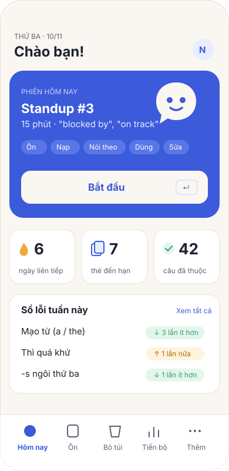
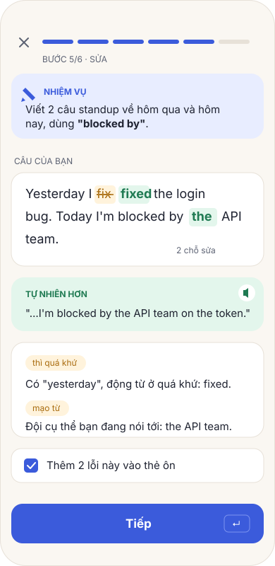
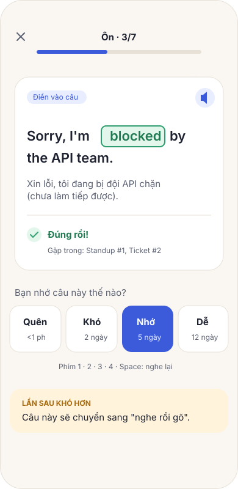
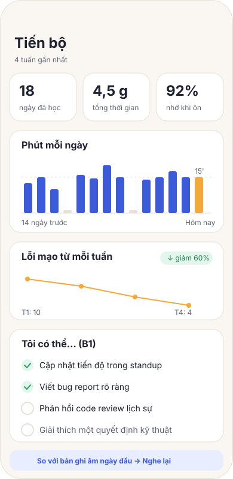

# FLUENTLOOP – THIẾT KẾ GIAO DIỆN VÀ MINH HOẠ

Mục tiêu: **sạch, ấm, dễ đọc**. Không cần đồ hoạ xuất sắc, nhưng mọi hình ảnh phải **cùng một phong cách**.

## 1. Cảm giác
- Giống một cuốn sổ tay gọn gàng, ấm áp và **có sức sống**, không giống bảng điều khiển hay game.
- Nền màu giấy ấm, chữ mực đậm, một màu chính cho thứ bấm được, và **mỗi bước học một màu nhận diện** (mục 2.1).
- Có phản hồi khi hoàn thành (tick nảy nhẹ, thanh bước đổi màu). Không dùng pháo hoa, điểm hay XP.
- Chuyển động ít và ngắn (150–250ms), tắt được, tôn trọng `prefers-reduced-motion`.

## 2. Design tokens (CSS variables)

| Token | Sáng | Tối | Dùng cho |
|---|---|---|---|
| `--paper` | `#FAF7F2` | `#16181D` | Nền |
| `--surface` | `#FFFFFF` | `#1F2229` | Thẻ |
| `--ink` | `#1E2230` | `#ECEDEF` | Chữ chính |
| `--ink-soft` | `#5B6172` | `#A3A8B4` | Chữ phụ |
| `--line` | `#E7E1D8` | `#2E323B` | Viền |
| `--primary` | `#3B5BDB` | `#7C93F0` | Nút chính, tiến độ |
| `--primary-tint` | `#E8EDFF` | `#26305A` | Nền nhấn nhẹ |
| `--accent` | `#F2A93B` | `#F5BA5C` | Chuỗi ngày, lỗi cần sửa (**thay cho đỏ**) |
| `--accent-tint` | `#FFF3DC` | `#3D3220` | Nền đoạn bị sửa |
| `--good` | `#2F9E6E` | `#4CC38A` | Đúng, chữ được thêm vào trong diff |
| `--good-tint` | `#E3F6EC` | `#1E3A2D` | Nền đúng |
| `--danger` | `#C92A2A` | `#FF8787` | **Chỉ** cho thao tác xoá không hoàn tác được (`Button variant="danger"`) |
| `--danger-tint` | `#FFF0F0` | `#3D1F22` | Nền khung xác nhận xoá |

- **Màu theo track:** mỗi ngành có một `--track` riêng (dev: chàm `#3B5BDB`, sau này điều dưỡng: xanh ngọc, khách sạn: cam đất...), dùng cho minh hoạ và nhãn. Màu nút chính không đổi.
- Không dùng đỏ cho lỗi. Màu đỏ chỉ dành cho thao tác nguy hiểm (xoá dữ liệu).

### 2.1 Màu theo bước và theo mục (`src/ui/tones.ts`)
Mỗi tông là một class `.tone-<tên>` đặt `--tone` và `--tone-tint`. Bên trong dùng `bg-tone`, `text-tone`, `bg-tone-tint`. Không đặt mã màu trực tiếp trong component.

| Tông | Sáng / Tối | Bước | Mục |
|---|---|---|---|
| `review` tím | `#7048E8` / `#B197FC` | Ôn | Hội thoại |
| `input` xanh ngọc | `#0B7285` / `#3BC9DB` | Nạp | Lộ trình |
| `shadow` cam | `#D9480F` / `#FF922B` | Nói theo | Bỏ túi |
| `produce` chàm | `#3B5BDB` / `#7C93F0` | Dùng | Hôm nay |
| `wrap` xanh lá | `#2B8A3E` / `#69DB7C` | Chốt | Tiến bộ |
| `fix` hổ phách | `#B35C00` / `#FFC078` | Sửa câu | Sổ lỗi |

- Màu tông dùng cho: đoạn trên thanh bước, `ToneIcon` (ô vuông có icon ở đầu bước, đầu trang, dòng điều hướng, gợi ý), tab đang chọn, số trong `StatTile`.
- **Không** dùng màu tông cho nút. Nút chính luôn là `--primary`.
- Chuyển động: `.pop` khi vào bước, `.burst` một lần ở màn Chốt. Cả hai tắt theo `prefers-reduced-motion`.

## 3. Chữ

### 3.1 Bốn vai trò chữ (bắt buộc cho mọi màn)
| Vai trò | Kiểu | Dùng cho |
|---|---|---|
| Nhãn (`Eyebrow`) | 12px, in hoa, đậm, màu tông | Đây là gì: "Đang học dở", "Đề bài", "Tiếp theo · bài 1/6" |
| Tiêu đề | 20–24px, đậm, `ink` | Tên bài, tên bước |
| Nội dung | 16px, `ink` | Điều người học cần đọc |
| Chú thích | 13–14px, `ink-soft` | Chỉ thông tin phụ, **tối đa một dòng** liền nhau |

- Danh sách cụm tiếng Anh luôn hiện dạng nhãn (`ChunkChips`) có tiêu đề ("Cụm sẽ học", "Cần dùng"), không viết thành một dòng chữ nối bằng dấu chấm.
- Tiến độ các bước dùng `StepTrail` (biểu tượng màu: đã xong có dấu tick, đang làm có nền), không viết thành câu kiểu "Bước 2/4".
- Lời giải thích: một câu ngắn. Không nhắc lại điều màn hình đã thể hiện. Không hiện số 0.

- **Be Vietnam Pro** (variable) cho giao diện. Dấu tiếng Việt đẹp, đọc tốt cả tiếng Anh.
- **JetBrains Mono** cho đoạn code, tên lệnh, thông báo lỗi trong snippet ngành dev.
- Cỡ chữ: câu học 20–22px, chữ thường 16px, chú thích 13px. Câu tiếng Anh đang học luôn là chữ to nhất trên màn hình.

## 4. Thành phần chính
| Component | Ghi chú |
|---|---|
| `StepHeader` | Đầu mỗi bước: `ToneIcon` (pop), tiêu đề lớn, một dòng hướng dẫn, số thứ tự bên phải |
| `SyncBadge` | Chỉ hiện khi đã bật đồng bộ, đặt cạnh `AiBadge` ở Hôm nay: đã đồng bộ / đang đồng bộ / offline / lỗi (bấm là tới Cài đặt mục Đồng bộ). Hết phiên đăng nhập thì thành nút hổ phách "Đồng bộ", bấm là đăng nhập lại ngay |
| `AiBadge` | Trạng thái AI (bật · tên nhà cung cấp / chưa có key / tắt), bấm là tới Cài đặt mục AI, ← quay về đúng chỗ. Đặt ở mọi màn có dùng AI: Hôm nay, phiên học (dạng gọn), Bỏ túi, Hội thoại |
| `ToneIcon` | Ô vuông màu tông kèm icon, 3 cỡ. `PageHeader look`, `NavRow look` dùng nó |
| `StepBar` | Đoạn trên cùng phiên học, màu theo bước. **Bấm được** để quay lại bước đã qua, bước chưa tới bị khoá |
| `PrimaryAction` / `CardAction` | Nút chính duy nhất của màn, phím `↵` trên desktop. Xem 4.1 |
| `SentenceCard` | Câu EN to, nút loa, chạm vào cụm để xem nghĩa (popover) |
| `MicButton` | Đủ các trạng thái: sẵn sàng / đang nghe / đã nghe / không nghe thấy / bị chặn / mất mạng |
| `Diff` | Chữ bị bỏ: gạch ngang trên nền hổ phách. Chữ thêm vào: nền xanh. Có tóm tắt "1 chỗ sửa" |
| `FeedbackPanel` | **Một khung duy nhất** cho nhận xét: đủ ý → cụm → lỗi (diff + chọn thành thẻ) → nâng cấp → khen. Thay cho các khung rời. Không truyền hàm chọn thì là bản chỉ xem (Bài viết của tôi): cái đã thành thẻ ghi "Đã thành thẻ ôn" |
| `WritingRow` | Một dòng `NavRow` cho một đề đã làm: đề, số lần làm, ngày gần nhất, đủ ý hay chưa. Dùng ở Bài viết của tôi và Trang bài |
| `HintBox` | Gợi ý 3 bậc, mở dần |
| `PatternCard` | Khung mẫu câu của bài (gói Nền): công thức, 3–4 câu ví dụ có loa, một ghi chú. Hiện thẳng ở bước Nạp và trang bài, không thu gọn, vì người học cần nó để viết |
| `SoundTips` | Âm cần chú ý trong câu đang nói theo: từ, cách đặt miệng, loa chậm. Câu không có âm nào thì không hiện |
| Luyện nói | Trang `/roleplay` mở đầu bằng `NavList` hai dòng (Nói liền, Sau buổi nói), rồi tới danh sách hội thoại. Màn tập trung (Nói liền, Hội thoại, Sau buổi nói) không có thanh tab. Đang ghi âm thì nút chính là "Dừng", có đồng hồ, thanh độ to và phụ đề chạy |
| `RatingRow` | 4 mức FSRS với chữ thân thiện: Quên · Khó · Nhớ · Dễ |
| `StatTile` | Số to kèm nhãn nhỏ, có thể theo tông. Ở Chốt chỉ hiện ô có số lớn hơn 0 |
| `EmptyState` | Luôn có minh hoạ, một câu và một nút |
| `OptionButton` | Một lựa chọn dạng dòng lớn (52px): đáp án trắc nghiệm, chọn số phút, chọn ngành (`dot` là màu ngành). `selected` thì viền xanh và có dấu tick, `keyHint` hiện phím tắt trên màn rộng |
| `Section` | Một phần của màn dài (Cài đặt): icon theo tông, tiêu đề, một dòng mô tả, trạng thái bên phải (`Chip` "Đang bật"). Nội dung (thường là `Card`) nằm dưới |
| `LuBurst` | Lu kèm chấm màu bung ra một lần: chỉ dùng ở chỗ kết thúc (Chốt phiên, xong màn Bắt đầu) |

### 4.1 Quy tắc chỗ bấm (bắt buộc cho mọi màn)
Mục tiêu: người chỉ muốn học thấy ngay một việc, người muốn khám phá có chỗ rõ ràng, không bấm nhầm trên điện thoại.

| Loại | Component (`src/ui/ui.tsx`) | Dùng khi |
|---|---|---|
| Nút chính, **một** mỗi màn | `PrimaryAction` (dính đáy, màn tập trung không có thanh tab) hoặc `CardAction` (trong thẻ, màn có thanh tab) | Bắt đầu, Học tiếp, Tiếp |
| Nút phụ | `Button` variant secondary | Thao tác ngang hàng trong thẻ |
| Dòng điều hướng | `NavList` + `NavRow` (cả dòng bấm được, cao 52px, icon trái, › phải) | Đi tới màn khác |
| Link phụ trong thẻ | class `linkButton` (có viền, cao 40px) | "Xem sổ lỗi", "Viết", "Hiện tiếng Việt" |
| Quay lại | `PageHeader back` (mũi tên ←, 44px, bên trái) | Mọi màn con |
| Chọn một trong danh sách (màn tập trung) | `OptionButton`, xếp dọc | Đáp án bài xếp mức, số phút mỗi ngày |
| Hiếm dùng / nguy hiểm | `MoreMenu` (⋯), luôn `confirm` | Bỏ phiên |
| Xoá dữ liệu | Hai bước: nút phụ chữ đỏ mở khung xác nhận (gợi ý sao lưu, ô tích "Tôi hiểu"), rồi mới tới `Button variant="danger"`. Đặt cuối màn, tách khỏi phần khác | Xoá dữ liệu học |
| Mở thêm hướng dẫn | Hiện thẳng, không giấu trong `
` nếu người dùng cần để làm xong việc | Các bước chuyển máy |

- **Màu xanh chỉ dành cho thứ bấm được.** Nhãn (`Chip`) dùng nền trung tính; `tone="track"` chỉ thêm chấm màu ngành. Ngoại lệ: khung giải thích cụm (`ChunkGloss`) tô xanh nhạt để nối với cụm đang chọn. Nhãn, cụm từ, các bước, chữ thông tin dùng `ink` hoặc `ink-soft`.
- Chữ xanh gạch chân chỉ dùng cho link **nằm trong câu** (ví dụ "lấy key ở đây").
- Mọi chỗ bấm ≥ 40px, nút chính ≥ 52px. Link phụ không nằm sát nút chính.

## 5. Hệ thống minh hoạ

**Phong cách:** hình phẳng, nét viền 2px bo tròn, tối đa 3 màu (`--ink`, `--track`, `--accent`) trên nền `--paper`. Không gradient, không bóng đổ phức tạp. Tô màu bằng `currentColor` và CSS variables, nên **tự đổi màu theo theme và theo track**.

Có ba lớp, từ dễ đến khó:

1. **Icon:** Lucide (nét 2px, bo tròn), đúng với phong cách trên. Dùng cho toàn bộ giao diện.
2. **Hình theo bước** (6 hình, tự vẽ SVG, khoảng 120×120): Ôn = chồng thẻ, Nạp = trang giấy kèm tai nghe, Nói theo = sóng âm, Dùng = bút, Sửa = hai dòng diff, Chốt = dấu tick trong vòng lặp. Vẽ một lần, dùng mãi.
3. **Hình theo chủ đề và trạng thái trống** (khoảng 10–15 hình): có ba nguồn, chọn một nguồn để giữ đồng bộ:
   - **Tự vẽ SVG** theo phong cách trên (Claude vẽ được dạng hình khối đơn giản). Đây là phương án đề xuất, vì đồng bộ tuyệt đối và nhẹ.
   - **Open Peeps / Humaaans** (giấy phép CC0) nếu muốn có hình người. Tô lại bằng 3 màu của mình.
   - Ảnh do AI tạo: **không khuyến khích**, vì khó đồng bộ phong cách và nặng.

**Mascot (tuỳ chọn):** "Lu", một bong bóng thoại tròn có mắt, chính là hình trong logo. Lu chỉ xuất hiện ở Chốt, ở trạng thái trống và ở onboarding, không chen vào giữa lúc học.

Minh hoạ mẫu và mockup trong `docs/mockups/` đã theo đúng hệ màu này.

## 6. Bố cục
- Mobile trước: một cột, rộng tối đa 560px, lề 16px, nút chính ở vùng ngón cái chạm tới.
- Desktop: cột học ở giữa (tối đa 640px), menu bên trái (Hôm nay · Ôn · Hội thoại · Bỏ túi · Sổ lỗi · Tiến bộ). Mobile thì dùng tab bar dưới, gồm 4 mục chính và mục "Thêm".
- Trong phiên học ẩn menu, chỉ có `StepBar` và nút thoát.

## 7. Giọng văn (copy)
- Tiếng Việt, ngắn, xưng "bạn", động viên cụ thể, không sáo rỗng.
- Đúng: *"Gần đúng rồi. Chỉ thiếu 'the' trước 'API'."* Sai: *"Sai! Thử lại."*
- Nút là động từ: **Bắt đầu**, **Nghe lại**, **Kiểm tra**, **Tiếp**, **Xong hôm nay**.

## 8. Mockup
| | |
|---|---|
|  |  |
|  |  |

Mockup chỉ để định hướng bố cục và màu. Chi tiết sẽ chốt khi làm từng sprint.
